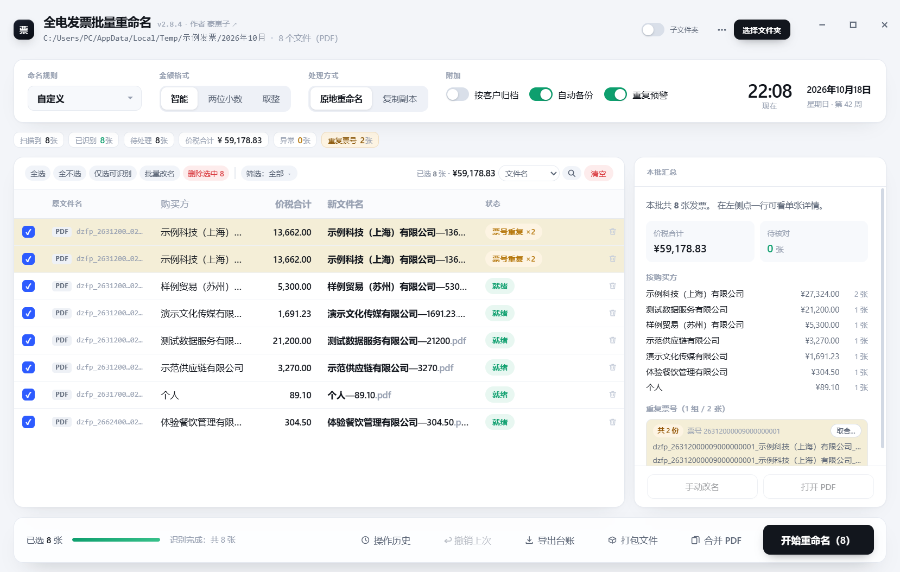

# 全电发票批量重命名工具（Invoice Renaming Tool）

> 给财务和代理记账用的 Windows 桌面小工具：**把一堆 PDF / OFD / XML 数电票，按「购买方—金额」自动改成一眼能看懂的文件名**，外加查重、风控校验、红冲关联和一键打包。

不需要联网、不上传任何发票内容，纯本地运行。双击安装，装完即用。




<sub>截图使用合成示例数据，不含任何真实发票。</sub>

---

## 为什么会有这个工具

月底从电子税务局批量下载发票，拿到的文件名都是 `dzfp_26312000005847746825_上海某某文化传媒有限公司_20260915141205.pdf` 这种：
**票号 + 公司名 + 时间戳**，签章页刷不出来，想知道"这张多少钱"只能一个个打开。

这个小工具做的事很简单：读票面 → 提取字段 → 按你定的规则重命名。顺带把财务真正会踩的坑（重号、红冲、大小写金额对不上、跨月重复报销）先筛一遍。

---

## 功能一览

### 识别
- **三种格式**：PDF（文本层 / 扫描件除外）、OFD、XML（数电票原生数据）
- **压缩包直接拖**：zip/rar/7z 里的发票会自动解出并识别
- **加密 PDF**：识别到加密会提示输密码，不用先手动解密
- **一票多页**：一个 PDF 里装了好几张票时，可以按页拆成独立文件
- **凭证配对**：同一趟出差的行程单 / 火车票，会跟着发票一起改名

### 命名
- **13 个可用字段**：购买方、销售方、价税合计、开票日期、发票号码、项目名称、备注、购买方税号……
- **自由组合**：拖动排序，自定义分隔符（`—`、`_`、空格都行）
- **金额格式**：智能（整数不带小数）/ 两位小数 / 取整
- **模板库**：常用规则存起来，下个月一键套用
- **批量改名**：给勾选的这批统一加前缀、后缀或替换文字
- **可撤销**：改名有操作记录，改错了整批回退（不是逐条撤销）

### 校验（全部离线，规则公开可查）
- **发票号码**：位数、格式
- **纳税人识别号**：18 位统一社会信用代码校验位
- **大小写金额**：票面「价税合计（大写）」与数字金额逐位比对
- **日期**：非法日期、未来日期
- **票号重复**：同一批内同票号分组高亮（一组一色，最多 24 色）
- **跨批次重复**：这张票上月是不是已经处理过（本地留台账，不联网）
- **红字 ↔ 蓝票**：负数票自动找金额相反、购销方相同的蓝票，互相跳转

### 批量与交付
- **打包文件**：按购买方归档 + 生成报销清单 Excel（金额、张数、票号）
- **导出账本**：Excel 台账（含按购买方、按月份两个汇总视角）
- **合并 PDF**：把一批票合成一个文件，方便发给会计
- **批量删除**：勾一批 / 筛出来一批，一次从列表移除（不删磁盘文件）

### 界面
- 三栏布局：列表 / 票面预览 / 字段定位，点行即看票
- 左侧点字段，右侧票面框出位置，对不上时一眼看出是哪一栏读错了
- 无系统标题栏，窗口按钮画在界面里（可用环境变量回退，见下）
- 搜索、筛选（需处理 / 重复 / 多张票 / 失败）、按金额或日期排序

> 界面只有一张截图（合成数据）。票面预览、字段定位等功能请在软件里看——
> 那部分必然带着发票内容，不适合放在公开仓库。

---

## 下载安装

到 [Releases](https://github.com/tugepaopao/Invoice-Renaming-Tool/releases) 下载最新版：

```
Invoice-Renaming-Tool-Setup-v2.8.4.exe   （约 26 MB）
```

> 自己从源码打包时，产物是中文名的 `发票批量重命名工具_安装程序_v2.8.4.exe`，内容完全相同。

双击安装 → 选安装位置 → 完成，桌面会有快捷方式，控制面板可卸载。

**系统要求**：Windows 10 / 11（64 位）。WebView2 运行时 Win11 自带，Win10 若缺失安装程序会提示。

> ⚠️ **关于杀毒软件误报**
> 安装包用 PyInstaller 打包且未做代码签名，360 / 火绒 / Windows Defender 偶尔会报"未知程序"。
> 这是打包方式的通病，不是病毒。处理办法：加入信任区，或右键 →「仍要运行」。
> 想彻底避免只能买代码签名证书（一年几千元），个人项目一般不做。

---

## 快速上手（4 步）

1. **选文件夹**：把发票（PDF / OFD / XML，或压缩包）放在一个文件夹里，点右上「选择文件夹」，或者直接把文件夹拖进窗口。
2. **定规则**：默认规则是 `购买方—金额`，够用就直接跳到下一步。想改点「命名规则」，拖动字段排序、改分隔符。
3. **看一眼状态列**：绿色的「就绪」可以直接改；「待核对」的鼠标停上去会说明原因（金额对不上、号码位数不对等）。
4. **开始重命名**：确认无误点右下角「开始重命名」。改完想反悔，点「撤销上次」。

---

## 支持的字段

| 字段 | PDF | OFD | XML | 说明 |
|---|:--:|:--:|:--:|---|
| 购买方名称 | ✅ | ✅ | ✅ | 最常用字段 |
| 销售方名称 | ✅ | ✅ | ✅ | |
| 价税合计 | ✅ | ✅ | ✅ | 支持负数（红字票） |
| 价税合计（大写） | ✅ | ✅ | ✅ | 用于交叉校验 |
| 开票日期 | ✅ | ✅ | ✅ | |
| 发票号码 | ✅ | ✅ | ✅ | 20 位 |
| 购买方 / 销售方税号 | ✅ | ✅ | ✅ | |
| 项目名称 | ✅ | ✅ | ✅ | 多行会取第一行 |
| 备注 | ✅ | ✅ | ✅ | 常为空，命名时会自动跳过 |
| 开票人 | ✅ | ✅ | ✅ | |

> 扫描件（纯图片 PDF）读不出来——没有文本层，OCR 不在本工具范围内。

---

## 一些实现上的坑（给二次开发者）

- **OFD 有两种形态**：标准数电票 OFD 带 `Tags/CustomTag.xml` 映射表；由 PDF 硬转的 OFD 没有映射表，只能**按坐标回退**（标签在 `PageBlock` 外，值在 `TextCode` 的 X/Y 上）。两种都要处理，否则一半的 OFD 会"识别不出金额"。
- **竖排表头必须过滤**：「购 买 方 信 息」是一字一个 TextObject、同 x 逐字递增，不过滤会粘到字段值上。
- **大小写金额换算要逐位扫全串**：按「每 4 位一组」分别拼会漏掉跨组的「零」（`206867` 会算成「贰拾万陆佰…」）。
- **20 位发票号码不能用 CSV**：Excel 打开 CSV 会变科学计数法、末几位丢失。台账一律 xlsx。
- **无边框窗口**：`frameless=True` 会把缩放边框一起删掉，必须用 Win32 把 `WS_THICKFRAME` 补回来；拖动走 `WM_NCLBUTTONDOWN(HTCAPTION)`；顶部那条 8px 白边要用 `WM_NCCALCSIZE` + 一次 1px 抖动消掉。

---

## 从源码运行

```bash
git clone https://github.com/tugepaopao/Invoice-Renaming-Tool.git
cd Invoice-Renaming-Tool

python -m venv .venv
.venv\Scripts\activate

pip install -r requirements.txt -i https://mirrors.aliyun.com/pypi/simple/
python app.py
```

国内建议用阿里云镜像（官方源经常卡）。依赖只有三个：`pywebview`、`PyMuPDF`、`openpyxl`。

### 打包成 exe / 安装包

```bash
.venv\Scripts\python.exe tools\build.py            # 完整打包（PyInstaller + NSIS）
.venv\Scripts\python.exe tools\build.py --setup-only   # 只重打安装包
```

产物：`dist\发票批量重命名工具\`（免安装目录）和 `安装包\..._安装程序_v2.8.4.exe`。
NSIS 编译器项目里带了便携版（`tools/_nsis`），不用另装。

### 跑测试

```bash
.venv\Scripts\python.exe tools\test_parser.py   # 281 项：三格式解析一致性
.venv\Scripts\python.exe tools\test_check.py    # 66 项：大写金额 / 税号校验位 / 号码 / 日期
.venv\Scripts\python.exe tools\test_bridge.py
.venv\Scripts\python.exe tools\test_merge.py
```

`tests/` 里只放**合成样票**（文件名带「某某」的那些）。真实发票样本一律不入库——
仓库是公开的，发票上有公司名、税号、金额，属于敏感信息。

---

## 目录结构

```
.
├── app.py                # 入口：建窗口、无边框标题栏、启动参数
├── bridge.py             # 前端与 Python 的桥（所有 pywebview API）
├── invoice_parser.py     # 核心：PDF / OFD / XML 解析与字段提取
├── check_core.py         # 离线风控：号码 / 税号 / 大小写金额 / 日期
├── rename_core.py        # 改名规则、模板、前缀后缀
├── pair_core.py          # 凭证配对（发票 ↔ 行程单）
├── merge_core.py         # 合并 PDF
├── preview_core.py       # 票面渲染与大图
├── export_core.py        # 台账 / 报销清单（openpyxl）
├── dup_history.py        # 跨批次台账（本地 JSON）
├── cache_core.py         # 解析结果缓存
├── version.py            # 版本号（唯一来源之一）
├── installer.nsi         # NSIS 安装包脚本
├── web/                  # 界面（原生 HTML/CSS/JS，无框架）
│   ├── index.html
│   ├── style.css
│   └── app.js
├── tools/                # 构建脚本与测试
├── tests/                # 合成样票
└── docs/                 # 说明文档与截图
```

---

## 文档

- [`docs/使用说明.md`](docs/使用说明.md) —— 图文操作手册（每一步点哪里、填什么）
- [`docs/优化建议.md`](docs/优化建议.md) —— 需求台账与每个版本的实现记录

## 常见问题

**Q：识别出来的金额是「—」？**
A：三种可能：① 扫描件（没有文本层）；② PDF 加密（状态列会显示「密码」，点它输密码）；③ OFD 是硬转的，坐标回退没命中——把这张票发我，我加规则。

**Q：想用系统原生的标题栏？**
A：设环境变量 `INVOICE_NATIVE_FRAME=1` 再启动，窗口会回到带系统标题栏的样子。

**Q：会不会把我的发票上传到网上？**
A：不会。工具全程离线，不发任何网络请求（唯一会联网的动作是你点作者名字打开这个 GitHub 页面）。

**Q：能识别截图 / 手机拍的发票吗？**
A：不能。扫描件需要 OCR，本工具不做——准确率不够反而添乱。

---

## 更新日志

| 版本 | 主要变化 |
|---|---|
| v2.8.4 | 顶栏版本/作者与标题对齐、上下留白一致 |
| v2.8.3 | 顶栏做减法：只留一个主按钮，低频操作收进 ⋯ |
| v2.8.1 | 消除顶部白边；修「单击窗口会下移」；搜索展开不遮挡 |
| v2.8.0 | 去掉系统标题栏，窗口按钮并入界面 |
| v2.7 | 规则卡、状态筛选、搜索排序、跨批次预警、红冲关联 |
| v2.6 | 三栏布局、票面预览、模板库 |
| v2.5 | OFD / XML 支持、凭证配对、合并 PDF |

完整变更见 [Releases](https://github.com/tugepaopao/Invoice-Renaming-Tool/releases)。

---

## 免责声明

本工具只做**文件重命名与本地校验**，不修改发票内容、不生成发票、不连接税务系统，也不替代任何官方查验渠道。
校验结果仅供参考，报销与入账请以票面原件和税务系统为准。

仅供学习与个人/企业内部使用。
